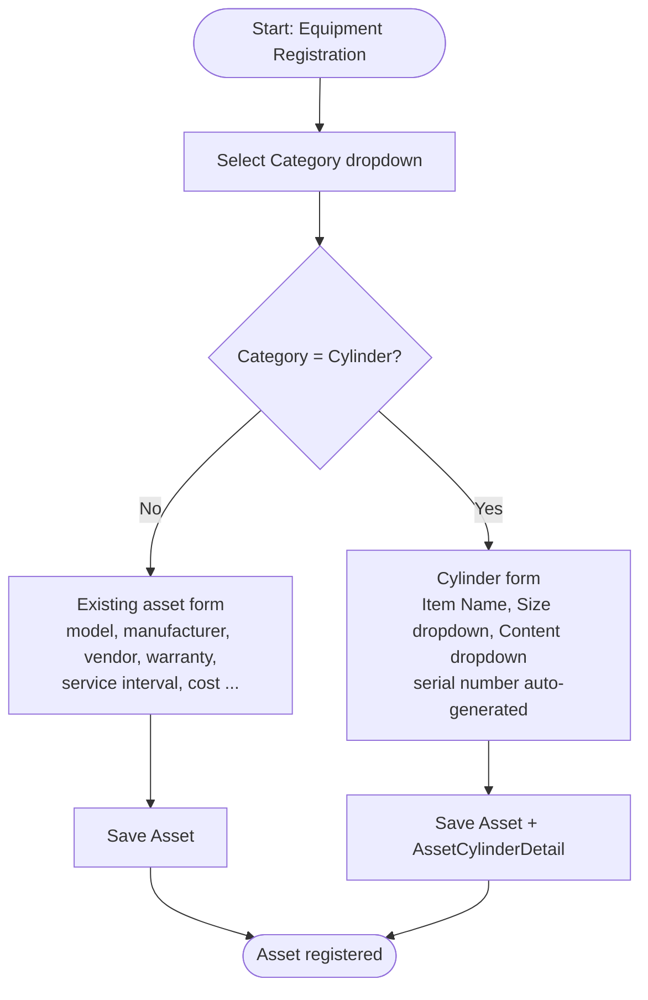
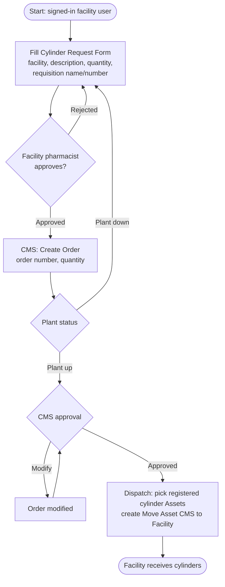
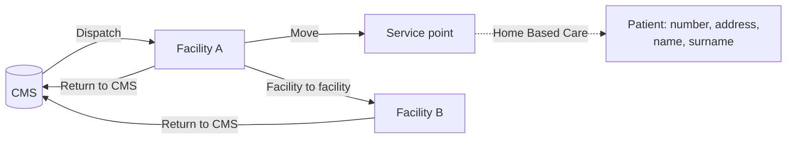
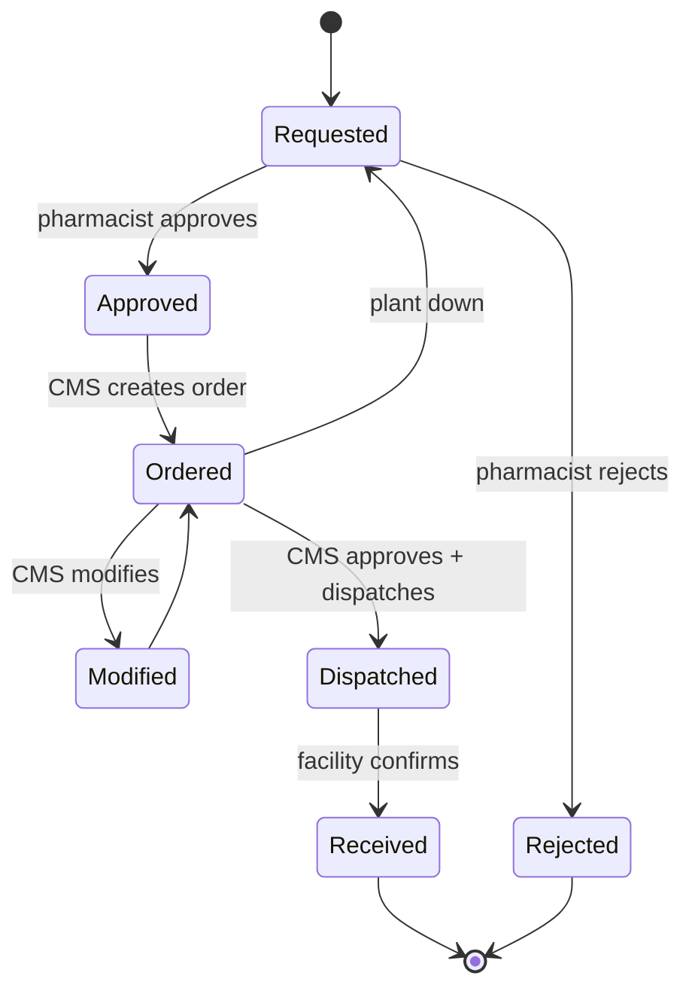
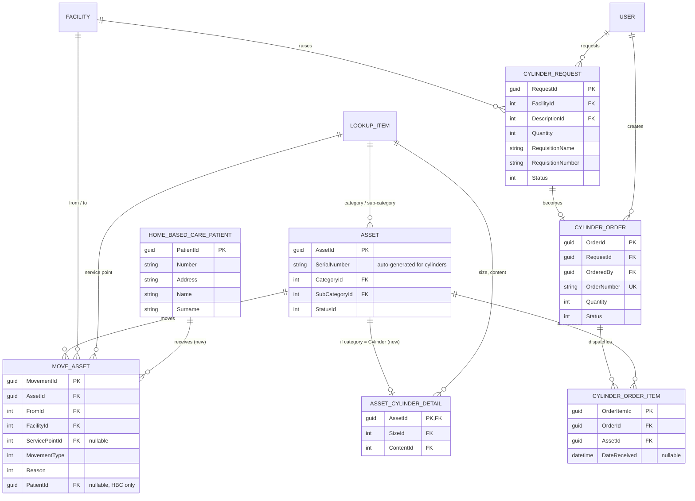

# Oxygen Cylinder Tracking – Design (integrated into EMMS asset flow)

Derived from the whiteboard sketches. Diagrams use Mermaid (render in VS Code / GitHub).

## Approach

Cylinders are **not a separate module**. They are `Asset` records, registered through the existing Equipment Registration form and moved with the existing Move Asset flow.

| Concern | Existing EMMS piece reused | What is added |
|---|---|---|
| Registration | `Asset` + `AssetRegistrationViewModel`; `Category` → `SubCategory` (Item Name) dropdowns backed by `LookupItem` | Category lookup item **Cylinder**, with SubCategory items (e.g. Oxygen Cylinder); cylinder-only fields **Size** and **Content** (dropdowns) |
| Serial number | `Asset.SerialNumber` (required) | Auto-generated for cylinders (hidden from the form, per sketch) |
| Movements | `MoveAsset` (facility → facility, service point, approval, receive) | Cylinder movement types; optional home-based-care patient |
| Ordering | – | New: `CylinderRequest`, `CylinderOrder`, `CylinderOrderItem` |

## 1. Registration flow – category-driven form



Sketch of the form fields for the Cylinder category:

```
Equipment ▸ Category: Cylinder ▸ Item Name: [dropdown]
 ├─ Id                (system)
 ├─ Serial number     (struck out on sketch → auto-generated, unique)
 ├─ Barcode           (struck out → not captured)
 ├─ Size              [dropdown]
 ├─ Expiry            (struck out → not captured)
 └─ Content           [dropdown]
```

## 2. Request, approval and dispatch flow



## 3. Cylinder movement flow (uses Move Asset)



## 4. Order status



## 5. ERD

Existing tables are shown with only the relevant columns. New tables are marked **(new)**.



## 6. Schema

See [schema.sql](schema.sql): lookup seed data, new tables, and one `ALTER` on `MoveAssets`.

## 7. Assumptions to confirm

- **Cylinder-specific fields** are held in a 1:1 extension table (`AssetCylinderDetails`) so `Assets` stays unchanged. Alternative: nullable `SizeId` / `ContentId` on `Assets`.
- **Asset fields hidden for cylinders**: model, manufacturer, vendor, service provider, placement, warranty, service interval. Existing `[Required]` attributes on `Asset` must become conditional on category (like the current `RequiredIf` pattern), or receive defaults for cylinders.
- **Size / Content** are new `LookupList`s (e.g. sizes 2 L / 5 L / 10 L; content Oxygen / Medical Air). Values are placeholders.
- **CMS is a `Facility` row**, so dispatch and return-to-CMS are ordinary Move Asset records. If it is not, `FromId`/`FacilityId` need a null-means-CMS convention.
- **Ordered cylinders must already be registered** as assets; dispatch selects specific serial-numbered cylinders.
- **"Plant down"** = CMS cannot fill the order; it returns to the request form.
- **Second diamond** = CMS approval with outcomes Modify (loops back) and Approved (dispatch).
- The sketch's movement fields were partly illegible; the existing `MoveAsset` fields are used instead.
